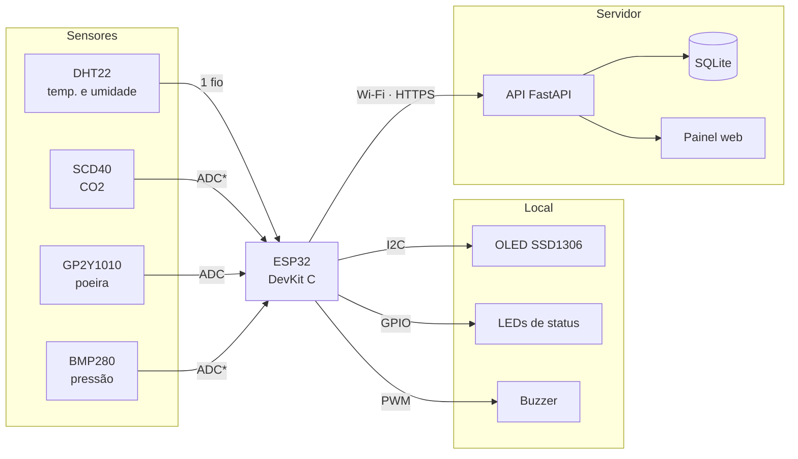

<div align="center">

# 🌬️ AirSense

**Sistema de monitoramento da qualidade do ar e das condições climáticas para ambientes internos**

[](https://github.com/DaviFCSilva/air-sense/actions/workflows/ci.yml)


Projeto extensionista de Microcontroladores · Estácio Ribeirânia · Ribeirão Preto/SP · 2026

**[📋 Resumo do projeto](docs/resumo-do-projeto.md)** ·
**[▶️ Como rodar](docs/como-rodar.md)** ·
**[🧩 Arquitetura](docs/arquitetura.md)** ·
**[🔌 API](api/README.md)**

</div>

---

## Sumário

- [Sobre o projeto](#sobre-o-projeto)
- [Funcionalidades](#funcionalidades)
- [Início rápido](#início-rápido)
- [Arquitetura](#arquitetura)
- [Hardware](#hardware)
- [Como funciona a classificação](#como-funciona-a-classificação)
- [Estrutura do repositório](#estrutura-do-repositório)
- [Roadmap](#roadmap)
- [Equipe](#equipe)
- [Referências](#referências)

## Sobre o projeto

Em escritórios fechados, o ar-condicionado ligado o dia todo e a pouca renovação
de ar fazem o **CO2 se acumular**, aumentam a quantidade de **material
particulado** e deixam a **temperatura e a umidade** fora da faixa de conforto.
O problema é silencioso: normalmente só é percebido quando as pessoas já estão
com sonolência, dor de cabeça ou dificuldade de concentração.

Estudos de Harvard (Allen et al., 2016) mostram que, em ambientes bem
ventilados e com pouco CO2, o desempenho cognitivo dos trabalhadores foi
**101 % maior** do que nas condições convencionais. Mesmo assim, as soluções
comerciais de monitoramento contínuo costumam ser caras demais para a maioria
das empresas.

O **AirSense** é um dispositivo de baixo custo baseado em **ESP32** que mede
continuamente o ar do ambiente, mostra os valores em um display, avisa com
LEDs e alarme sonoro quando as condições saem dos limites da
**Resolução ANVISA RE nº 9/2003** e envia as leituras para um **painel web**
com histórico.

> Projeto desenvolvido para a disciplina de Microcontroladores, na modalidade
> extensionista, em parceria com um escritório corporativo, sob orientação do
> **Prof. Omar Donaires**.

## Funcionalidades

- 📊 Medição de **CO2, material particulado, temperatura, umidade e pressão**
- 🖥️ Exibição em tempo real em um **display OLED 128×64**
- 🚦 **LEDs de status**: verde (OK), amarelo (ATENÇÃO) e vermelho (ALERTA)
- 🔔 **Alarme sonoro por PWM** quando um limite da norma é ultrapassado
- 📡 **Envio das leituras por Wi-Fi** para a API a cada 5 segundos
- 📈 **Painel web** com status, gráficos com os limites da ANVISA e histórico
- ⚠️ Detecção de **falha no sensor** DHT22, sem gerar alerta falso
- 🔒 Credenciais fora do código (`secrets.h` e `.env`, nenhum dos dois vai para o Git)


<sub>Painel com dados gerados pelo <code>api/enviar_teste.py</code>.</sub>

## Início rápido

**Só a simulação (5 minutos, sem instalar nada):** abra
[wokwi.com/projects/new/esp32](https://wokwi.com/projects/new/esp32), cole os
arquivos de [`firmware/airsense/`](firmware/airsense/) e clique em ▶️.

**API e painel:**

```bash
cd api
python -m venv .venv && source .venv/bin/activate   # Windows: .venv\Scripts\activate
pip install -r requirements.txt
cp .env.example .env                                # e troque a API_KEY
uvicorn main:app --reload --port 8000               # painel em http://localhost:8000
```

Para ligar o Wokwi à API (túnel, `secrets.h` etc.), siga o
**[guia passo a passo](docs/como-rodar.md)**.

## Arquitetura



<sub>\* Na simulação, CO2 e pressão são potenciômetros no ADC. No hardware real, o SCD40 e o BMP280 passam para o barramento I2C.</sub>

Detalhes em **[docs/arquitetura.md](docs/arquitetura.md)**: escolha do
microcontrolador, periféricos internos, organização do firmware, fluxograma e
rotinas. O porquê de cada escolha está em **[docs/decisoes.md](docs/decisoes.md)**.

## Hardware

| Componente | Função | Interface | GPIO | Na simulação |
|---|---|---|---|---|
| ESP32 DevKit C V4 | Microcontrolador | — | — | ✅ Real |
| DHT22 | Temperatura e umidade | Digital (1 fio) | 15 | ✅ Real |
| SSD1306 128×64 | Display | I2C (`0x3C`) | 21 (SDA), 22 (SCL) | ✅ Real |
| SCD40 | CO2 | I2C | 34 | 🎛️ Potenciômetro (400–2000 ppm) |
| GP2Y1010AU0F | Poeira | Analógica | 35 | 🎛️ Potenciômetro (0–150 µg/m³) |
| BMP280 | Pressão | I2C | 32 | 🎛️ Potenciômetro (950–1050 hPa) |
| LED verde / amarelo / vermelho + 220 Ω | Status | GPIO | 25 / 26 / 27 | ✅ Real |
| Buzzer | Alarme | PWM (LEDC) | 33 | ✅ Real |

Especificações e componentes de apoio: **[docs/lista-de-materiais.md](docs/lista-de-materiais.md)**.

## Como funciona a classificação

A cada segundo, o firmware lê todos os sensores e classifica o ambiente em um
de três níveis. Os limites seguem a **ANVISA RE nº 9/2003**, que trata da
qualidade do ar interior em ambientes climatizados de uso coletivo. O nível
ATENÇÃO funciona como pré-alerta, em 80 % do limite.

| Grandeza | 🟢 OK | 🟡 ATENÇÃO | 🔴 ALERTA |
|---|---|---|---|
| CO2 | ≤ 800 ppm | > 800 ppm | > 1000 ppm |
| Material particulado | ≤ 64 µg/m³ | > 64 µg/m³ | > 80 µg/m³ |
| Temperatura | 23–26 °C | fora da faixa | — |
| Umidade relativa | 40–65 % | fora da faixa | — |

No nível **ALERTA**, o buzzer também apita. Os limites ficam em
[`config.h`](firmware/airsense/config.h).

<details>
<summary><b>Formato da saída no monitor serial</b></summary>

```
Conectando ao Wi-Fi "Wokwi-GUEST"......
Wi-Fi conectado! IP: 10.10.0.2
T=24.5C U=55% CO2=650ppm PM=20ug/m3 P=1013hPa nivel=0 (OK)
T=24.6C U=55% CO2=870ppm PM=22ug/m3 P=1013hPa nivel=1 (ATENCAO)
POST https://....trycloudflare.com/leituras -> 201
T=24.6C U=56% CO2=1150ppm PM=25ug/m3 P=1012hPa nivel=2 (ALERTA)
```

<sub>Valores ilustrativos.</sub>
</details>

## Estrutura do repositório

```
air-sense/
├── firmware/airsense/       # firmware do ESP32 + arquivos do Wokwi
│   ├── airsense.ino         #   setup, loop, display e serial
│   ├── config.h             #   pinos, limiares, tempos e rede
│   ├── sensores.h           #   leitura dos sensores
│   ├── alertas.h            #   classificação, LEDs e buzzer (PWM)
│   ├── rede.h               #   Wi-Fi e envio para a API
│   ├── secrets.example.h    #   modelo de credenciais (copiar para secrets.h)
│   ├── diagram.json         #   circuito do Wokwi
│   ├── libraries.txt        #   bibliotecas
│   └── wokwi.toml           #   Wokwi no VS Code
├── api/                     # API (FastAPI + SQLite) e painel web
│   ├── main.py
│   ├── static/index.html    #   painel
│   ├── enviar_teste.py      #   gera leituras falsas para testar
│   └── tests/               #   testes automatizados
├── docs/
│   ├── resumo-do-projeto.md # visão geral, situação e tarefas de cada integrante
│   ├── como-rodar.md        # passo a passo completo
│   ├── arquitetura.md       # detalhamento técnico (base do roteiro 2.6)
│   ├── decisoes.md          # por que o projeto é como é
│   └── lista-de-materiais.md
└── .github/workflows/ci.yml # compila o firmware e testa a API a cada push
```

## Roadmap

- [x] Definição do problema e do público (Diagnóstico e Teorização)
- [x] Planejamento: cronograma, metas, indicadores e recursos
- [x] Contato com o escritório parceiro
- [x] Simulação no Wokwi com sensores, display, LEDs e alarme
- [x] Limiares alinhados à ANVISA RE nº 9/2003
- [x] Firmware modular, sem `delay()`, com buzzer por PWM
- [x] Envio dos dados por Wi-Fi, API e painel web
- [x] CI: compilação do firmware e testes da API
- [ ] Registro da validação da proposta técnica com o escritório
- [ ] Interrupções: timer de leitura e botão para silenciar o alarme
- [ ] Firmware com os sensores reais (SCD40, GP2Y1010, BMP280)
- [ ] Montagem física em protoboard e calibração
- [ ] Testes de integração e de estabilidade (8 h contínuas)
- [ ] Apresentação ao escritório parceiro e avaliação de reação

O que cada integrante está fazendo: **[docs/resumo-do-projeto.md](docs/resumo-do-projeto.md)**.

## Equipe

**Grupo 12** — orientação do **Prof. Omar Donaires**

| Integrante | Papel |
|---|---|
| **Davi** | Documentação, Roteiro de Extensão, repositório e contato com o escritório parceiro |
| **Gabriel** | Arquitetura de hardware, circuito, montagem e calibração dos sensores |
| **Pedro Borges** | Testes de validação, exibição e análise dos dados (API e painel) |
| **Vinicius Barbosa** | Firmware em C, integração dos sensores e rotinas de alerta |

## Referências

- ALLEN, J. G. et al. **Associations of Cognitive Function Scores with Carbon Dioxide, Ventilation, and Volatile Organic Compound Exposures in Office Workers**. *Environmental Health Perspectives*, v. 124, n. 6, 2016. Disponível em: <https://pubmed.ncbi.nlm.nih.gov/26502459/>.
- BRASIL. Agência Nacional de Vigilância Sanitária. **Resolução RE nº 9, de 16 de janeiro de 2003**. Orientação técnica sobre padrões referenciais de qualidade do ar interior em ambientes climatizados artificialmente de uso público e coletivo.
- GBC BRASIL. **Qualidade do ar interno e rendimento no trabalho**. Disponível em: <https://www.gbcbrasil.org.br/qualidade-do-ar-interno-e-rendimento-no-trabalho/>.
- GBC BRASIL. **Síndrome do Edifício Doente: o que é, causas e como prevenir**. Disponível em: <https://www.gbcbrasil.org.br/sindrome-do-edificio-doente-o-que-e-causas-e-como-prevenir/>.
- ESPRESSIF. **ESP32 Technical Reference Manual**. Disponível em: <https://www.espressif.com/en/support/documents/technical-documents>.
- WOKWI. **ESP32 WiFi Networking**. Disponível em: <https://docs.wokwi.com/guides/esp32-wifi>.

---

<div align="center">
<sub>Estácio Ribeirânia · Ribeirão Preto/SP · 2026</sub>
</div>
