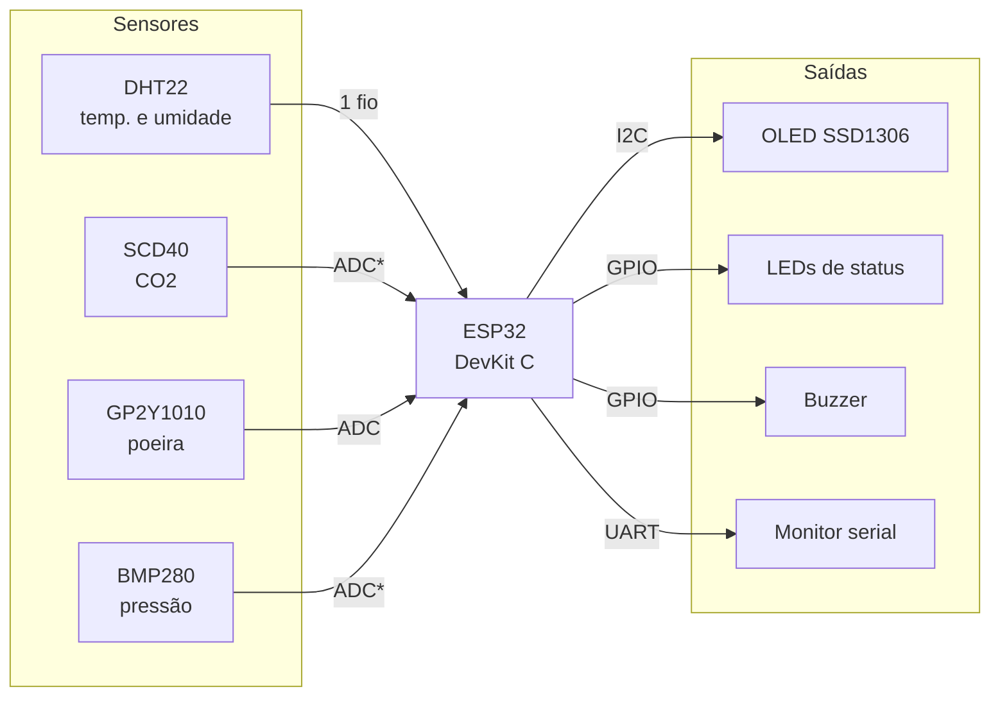

<div align="center">

# 🌬️ AirSense

**Sistema de monitoramento da qualidade do ar e das condições climáticas para ambientes internos**

[](https://github.com/DaviFCSilva/air-sense/actions/workflows/compilar.yml)


Projeto extensionista de Microcontroladores · Estácio Ribeirânia · Ribeirão Preto/SP · 2026

</div>

---

## Sumário

- [Sobre o projeto](#sobre-o-projeto)
- [Funcionalidades](#funcionalidades)
- [Arquitetura](#arquitetura)
- [Hardware](#hardware)
- [Como funciona a classificação](#como-funciona-a-classificação)
- [Como simular](#como-simular)
- [Estrutura do repositório](#estrutura-do-repositório)
- [Roadmap](#roadmap)
- [Equipe](#equipe)
- [Referências](#referências)

## Sobre o projeto

Em escritórios fechados, o ar-condicionado ligado o dia todo e a pouca renovação
de ar fazem o **CO2 se acumular**, aumentam a quantidade de **material
particulado** e deixam a **temperatura e a umidade** fora da faixa de conforto.
O problema é silencioso: normalmente só é percebido quando as pessoas já estão
com sonolência, dor de cabeça ou dificuldade de concentração.

Estudos de Harvard (Allen et al., 2016) mostram que, em ambientes bem
ventilados e com pouco CO2, o desempenho cognitivo dos trabalhadores foi
**101 % maior** do que nas condições convencionais. Mesmo assim, as soluções
comerciais de monitoramento contínuo costumam ser caras demais para a maioria
das empresas e dos coworkings.

O **AirSense** é um dispositivo de baixo custo baseado em **ESP32** que mede
continuamente o ar do ambiente, mostra os valores em um display e avisa com
LEDs e alarme sonoro quando as condições saem dos limites da
**Resolução ANVISA RE nº 9/2003**.

> Projeto desenvolvido para a disciplina de Microcontroladores, na modalidade
> extensionista, em parceria com um escritório corporativo, sob orientação do
> **Prof. Omar Donaires**.

## Funcionalidades

- 📊 Medição de **CO2, material particulado, temperatura, umidade e pressão**
- 🖥️ Exibição em tempo real em um **display OLED 128×64**
- 🚦 Indicação de status por **LEDs**: verde (OK), amarelo (ATENÇÃO) e vermelho (ALERTA)
- 🔔 **Alarme sonoro** quando algum limite da norma é ultrapassado
- 📝 **Log no monitor serial** a cada segundo, para análise dos dados
- ⚠️ Detecção de **falha no sensor** DHT22, sem gerar alerta falso

## Arquitetura



<sub>\* Na simulação, CO2 e pressão são potenciômetros no ADC. No hardware real, o SCD40 e o BMP280 passam para o barramento I2C.</sub>

O detalhamento completo, com a justificativa da escolha do microcontrolador,
os periféricos internos, o fluxograma do firmware e as rotinas principais, está
em **[docs/arquitetura.md](docs/arquitetura.md)**.

## Hardware

| Componente | Função | Interface | GPIO | Na simulação |
|---|---|---|---|---|
| ESP32 DevKit C V4 | Microcontrolador | — | — | ✅ Real |
| DHT22 | Temperatura e umidade | Digital (1 fio) | 15 | ✅ Real |
| SSD1306 128×64 | Display | I2C (`0x3C`) | 21 (SDA), 22 (SCL) | ✅ Real |
| SCD40 | CO2 | I2C | 34 | 🎛️ Potenciômetro (400–2000 ppm) |
| GP2Y1010AU0F | Poeira | Analógica | 35 | 🎛️ Potenciômetro (0–150 µg/m³) |
| BMP280 | Pressão | I2C | 32 | 🎛️ Potenciômetro (950–1050 hPa) |
| LED verde / amarelo / vermelho + 220 Ω | Status | GPIO | 25 / 26 / 27 | ✅ Real |
| Buzzer | Alarme | GPIO | 33 | ✅ Real |

Especificações e componentes de apoio: **[docs/lista-de-materiais.md](docs/lista-de-materiais.md)**.

## Como funciona a classificação

A cada segundo, o firmware lê todos os sensores e classifica o ambiente em um
de três níveis. Os limites seguem a **ANVISA RE nº 9/2003**, que trata da
qualidade do ar interior em ambientes climatizados de uso coletivo. O nível
ATENÇÃO funciona como pré-alerta, em 80 % do limite.

| Grandeza | 🟢 OK | 🟡 ATENÇÃO | 🔴 ALERTA |
|---|---|---|---|
| CO2 | ≤ 800 ppm | > 800 ppm | > 1000 ppm |
| Material particulado | ≤ 64 µg/m³ | > 64 µg/m³ | > 80 µg/m³ |
| Temperatura | 23–26 °C | fora da faixa | — |
| Umidade relativa | 40–65 % | fora da faixa | — |

No nível **ALERTA**, o buzzer também apita. Os limites ficam no começo do
[`sketch.ino`](simulacao/wokwi/sketch.ino) e podem ser ajustados facilmente.

<details>
<summary><b>Formato da saída no monitor serial</b></summary>

```
T=24.5C U=55% CO2=650ppm PM=20ug/m3 P=1013hPa nivel=0
T=24.6C U=55% CO2=870ppm PM=22ug/m3 P=1013hPa nivel=1
T=24.6C U=56% CO2=1150ppm PM=25ug/m3 P=1012hPa nivel=2
```

<sub>Valores ilustrativos. `nivel`: 0 = OK, 1 = ATENÇÃO, 2 = ALERTA.</sub>
</details>

## Como simular

### No navegador (Wokwi)

1. Abra **[wokwi.com/projects/new/esp32](https://wokwi.com/projects/new/esp32)**.
2. Substitua o conteúdo da aba `sketch.ino` pelo de [`simulacao/wokwi/sketch.ino`](simulacao/wokwi/sketch.ino).
3. Substitua o conteúdo da aba `diagram.json` pelo de [`simulacao/wokwi/diagram.json`](simulacao/wokwi/diagram.json).
4. Crie um arquivo `libraries.txt` (botão ▾ ao lado das abas → *New file…*) e cole o conteúdo de [`simulacao/wokwi/libraries.txt`](simulacao/wokwi/libraries.txt).
5. Clique em ▶️ **Start the simulation**.

**Para testar:** gire os potenciômetros para mudar CO2, poeira e pressão. Para
mudar temperatura e umidade, clique no DHT22 durante a simulação. Os LEDs e o
display respondem na hora.

### No VS Code (opcional)

Com a extensão [Wokwi Simulator](https://marketplace.visualstudio.com/items?itemName=wokwi.wokwi-vscode)
e o [arduino-cli](https://arduino.github.io/arduino-cli/) instalados:

```bash
# Uma vez só: core do ESP32 e bibliotecas
arduino-cli config add board_manager.additional_urls https://espressif.github.io/arduino-esp32/package_esp32_index.json
arduino-cli core update-index
arduino-cli core install esp32:esp32
arduino-cli lib install "Adafruit GFX Library" "Adafruit SSD1306" "DHT sensor library"

# Compila e gera o firmware em simulacao/wokwi/build/
cd simulacao/wokwi
arduino-cli compile --fqbn esp32:esp32:esp32 --output-dir build .
```

Depois, abra o `diagram.json` no VS Code e rode **Wokwi: Start Simulator**
(F1). O arquivo [`wokwi.toml`](simulacao/wokwi/wokwi.toml) já aponta para o
firmware compilado.

> Se o `arduino-cli` reclamar do nome da pasta, copie o `sketch.ino` para uma
> pasta chamada `sketch/` e compile a partir dela.

## Estrutura do repositório

```
air-sense/
├── .github/workflows/
│   └── compilar.yml        # CI: compila o firmware para ESP32 a cada push
├── docs/
│   ├── arquitetura.md      # MCU, pinagem, periféricos, fluxograma e rotinas
│   └── lista-de-materiais.md
├── firmware/
│   └── README.md           # versão para o hardware físico (planejada)
├── simulacao/wokwi/
│   ├── sketch.ino          # firmware em C/C++ (Arduino)
│   ├── diagram.json        # circuito do Wokwi
│   ├── libraries.txt       # bibliotecas usadas
│   └── wokwi.toml          # configuração para o VS Code
└── README.md
```

## Roadmap

- [x] Definição do problema e do público (Diagnóstico e Teorização)
- [x] Planejamento: cronograma, metas, indicadores e recursos
- [x] Simulação no Wokwi com leitura dos sensores, display, LEDs e alarme
- [x] Limiares alinhados à ANVISA RE nº 9/2003
- [x] Compilação automática no GitHub Actions
- [ ] Validação da proposta técnica com o escritório parceiro
- [ ] Buzzer por PWM (LEDC) e leituras por interrupção de timer
- [ ] Firmware com os sensores reais (SCD40, GP2Y1010, BMP280)
- [ ] Montagem física em protoboard e calibração
- [ ] Envio dos dados por Wi-Fi para um dashboard
- [ ] Testes de integração e de estabilidade (8 h contínuas)
- [ ] Apresentação ao escritório parceiro e avaliação de reação

## Equipe

**Grupo 12** — orientação do **Prof. Omar Donaires**

| Integrante | Papel |
|---|---|
| **Davi** | Documentação, Roteiro de Extensão e contato com o escritório parceiro |
| **Gabriel** | Arquitetura de hardware, montagem dos circuitos e calibração dos sensores |
| **Pedro Borges** | Testes de validação, exibição e análise dos dados |
| **Vinicius Barbosa** | Firmware em C, integração dos sensores e rotinas de alerta |

## Referências

- ALLEN, J. G. et al. **Associations of Cognitive Function Scores with Carbon Dioxide, Ventilation, and Volatile Organic Compound Exposures in Office Workers**. *Environmental Health Perspectives*, v. 124, n. 6, 2016. Disponível em: <https://pubmed.ncbi.nlm.nih.gov/26502459/>.
- BRASIL. Agência Nacional de Vigilância Sanitária. **Resolução RE nº 9, de 16 de janeiro de 2003**. Orientação técnica sobre padrões referenciais de qualidade do ar interior em ambientes climatizados artificialmente de uso público e coletivo.
- GBC BRASIL. **Qualidade do ar interno e rendimento no trabalho**. Disponível em: <https://www.gbcbrasil.org.br/qualidade-do-ar-interno-e-rendimento-no-trabalho/>.
- GBC BRASIL. **Síndrome do Edifício Doente: o que é, causas e como prevenir**. Disponível em: <https://www.gbcbrasil.org.br/sindrome-do-edificio-doente-o-que-e-causas-e-como-prevenir/>.
- ESPRESSIF. **ESP32 Technical Reference Manual**. Disponível em: <https://www.espressif.com/en/support/documents/technical-documents>.
- WOKWI. **Documentação do simulador**. Disponível em: <https://docs.wokwi.com/>.

---

<div align="center">
<sub>Estácio Ribeirânia · Ribeirão Preto/SP · 2026</sub>
</div>
