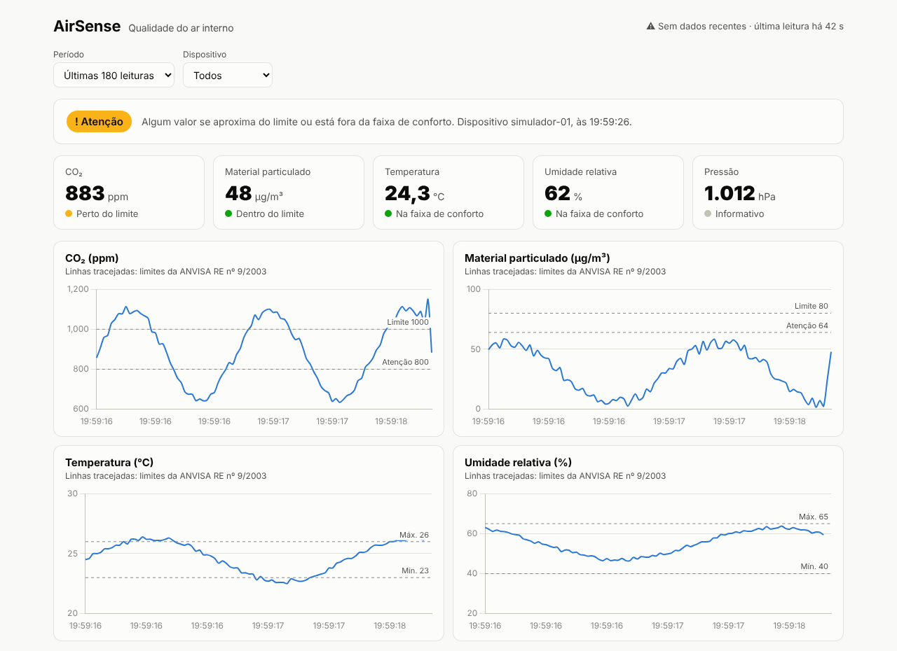

# API e painel do AirSense

Recebe as leituras enviadas pelo ESP32, guarda em um banco SQLite e mostra
tudo em um painel web que se atualiza sozinho a cada 5 segundos.

- **Tecnologias:** Python 3.10+, [FastAPI](https://fastapi.tiangolo.com/), SQLite e Chart.js
- **Responsável:** Pedro Borges (exibição e análise dos dados)



## Rodar

```bash
cd api
python -m venv .venv
# Windows:   .venv\Scripts\activate
# Linux/Mac: source .venv/bin/activate
pip install -r requirements.txt
cp .env.example .env          # no Windows: copy .env.example .env
# edite o .env e troque API_KEY por uma chave sua
uvicorn main:app --reload --port 8000
```

| Endereço | O que é |
|---|---|
| <http://localhost:8000/> | Painel |
| <http://localhost:8000/docs> | Documentação interativa (dá para testar as rotas pelo navegador) |
| <http://localhost:8000/saude> | Verificação rápida de que a API está no ar |

Para ver o painel com dados sem abrir o Wokwi, rode em outro terminal:

```bash
python enviar_teste.py
```

O passo a passo completo, incluindo como ligar o Wokwi a esta API, está em
[docs/como-rodar.md](../docs/como-rodar.md).

## Rotas

| Método | Rota | Chave? | Descrição |
|---|---|---|---|
| `POST` | `/leituras` | ✅ `x-api-key` | Grava uma leitura. Responde `201` com a leitura salva |
| `GET` | `/leituras?limite=100&device=` | — | Leituras da mais recente para a mais antiga (limite de 1 a 1000) |
| `GET` | `/leituras/ultima?device=` | — | Leitura mais recente (`404` se ainda não houver nenhuma) |
| `GET` | `/saude` | — | `{"status": "ok", "chave_configurada": true}` |
| `GET` | `/` | — | Painel web |

Só a gravação exige chave: as leituras de qualidade do ar não são sigilosas,
e o painel precisa ler sem login.

## Contrato do `POST /leituras`

Cabeçalhos:

```
Content-Type: application/json
x-api-key: <mesmo valor de API_KEY no .env>
```

Corpo (é exatamente o que o `firmware/airsense/rede.h` monta):

```json
{
  "device": "airsense-01",
  "temperatura": 24.5,
  "umidade": 55.0,
  "co2": 650,
  "poeira": 20.0,
  "pressao": 1013.0,
  "nivel": 0
}
```

| Campo | Tipo | Faixa aceita | Observação |
|---|---|---|---|
| `device` | texto | letras, números, `-` e `_` (até 64) | Identifica o dispositivo |
| `temperatura` | número ou `null` | −40 a 80 °C | `null` quando o DHT22 falha |
| `umidade` | número ou `null` | 0 a 100 % | `null` quando o DHT22 falha |
| `co2` | número | 0 a 40000 ppm | |
| `poeira` | número | 0 a 1000 µg/m³ | |
| `pressao` | número | 300 a 1100 hPa | |
| `nivel` | inteiro | 0, 1 ou 2 | 0 = OK, 1 = ATENÇÃO, 2 = ALERTA |

Respostas de erro:

| Código | Quando |
|---|---|
| `401` | Chave ausente ou errada |
| `422` | Campo faltando ou fora da faixa (o corpo da resposta diz qual) |
| `503` | O servidor está sem `API_KEY` no `.env` |

## Testes

```bash
pip install -r requirements-dev.txt
pytest
```

Os testes cobrem autenticação, gravação, consulta, filtros, validação e o
formato exato do JSON enviado pelo firmware. Eles rodam no GitHub Actions a
cada push.

## Arquivos

```
api/
├── main.py              # a API (rotas, validação, banco)
├── static/index.html    # o painel
├── enviar_teste.py      # envia leituras falsas para testar sem o Wokwi
├── tests/test_api.py    # testes automatizados
├── requirements.txt     # dependências para rodar
├── requirements-dev.txt # + dependências para testar
└── .env.example         # modelo do .env (o .env real não vai para o Git)
```
