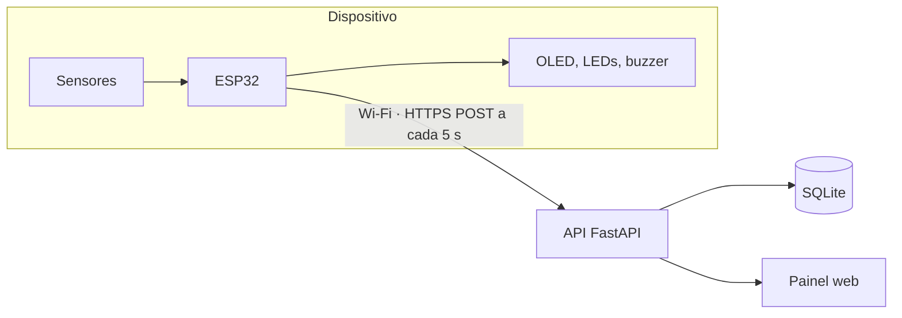
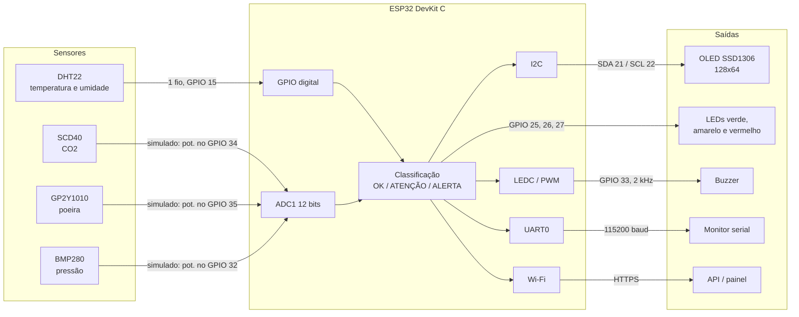
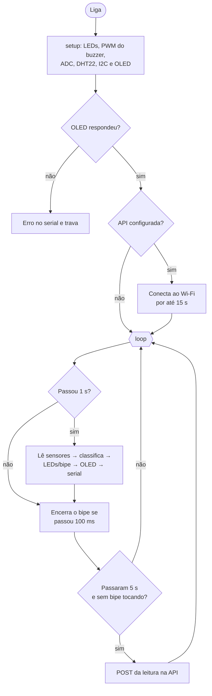

# Arquitetura do sistema embarcado

Este documento detalha como o AirSense foi construído e serve de base para a
seção **2.6 – Detalhamento técnico do projeto** do Roteiro de Extensão. O
porquê de cada escolha está em [decisoes.md](decisoes.md).

## Sumário

- [Visão geral](#visão-geral)
- [Escolha do microcontrolador](#escolha-do-microcontrolador)
- [Diagrama de blocos](#diagrama-de-blocos)
- [Pinagem](#pinagem)
- [Periféricos internos utilizados](#periféricos-internos-utilizados)
- [Organização do firmware](#organização-do-firmware)
- [Fluxo do firmware](#fluxo-do-firmware)
- [Rotinas e variáveis principais](#rotinas-e-variáveis-principais)
- [Comunicação com a API](#comunicação-com-a-api)
- [Próximos passos técnicos](#próximos-passos-técnicos)

## Visão geral



## Escolha do microcontrolador

Placa escolhida: **ESP32 DevKit C V4** (SoC ESP32-WROOM-32).

| Critério | Por que o ESP32 atende |
|---|---|
| Processamento | Dual-core Xtensa LX6 de até 240 MHz, com folga para sensores, display e HTTPS |
| Conectividade | Wi-Fi e Bluetooth integrados: envia os dados para a API sem módulos extras |
| Conversão analógica | ADC de 12 bits (0–4095) com vários canais |
| Barramentos | I2C, SPI e UART por hardware, compatíveis com o SCD40, o BMP280 e o OLED |
| PWM | Periférico LEDC com até 16 canais, usado no buzzer |
| Custo e tamanho | Placa compacta e barata, fácil de encontrar no Brasil |
| Simulação | Suporte nativo no Wokwi, inclusive Wi-Fi |

## Diagrama de blocos



> Na simulação, os sensores de CO2, poeira e pressão são potenciômetros ligados
> ao ADC. Na versão física, o SCD40 e o BMP280 passam para o barramento I2C, e o
> GP2Y1010 continua no ADC.

## Pinagem

| GPIO | Direção | Ligado a | Observação |
|---|---|---|---|
| 15 | Entrada/saída digital | DHT22 (dados) | Protocolo proprietário de 1 fio |
| 21 | I2C SDA | OLED SSD1306 | Endereço `0x3C` |
| 22 | I2C SCL | OLED SSD1306 | |
| 34 | Entrada analógica (ADC1_CH6) | Potenciômetro de CO2 | Pino somente de entrada |
| 35 | Entrada analógica (ADC1_CH7) | Potenciômetro de poeira | Pino somente de entrada |
| 32 | Entrada analógica (ADC1_CH4) | Potenciômetro de pressão | |
| 25 | Saída digital | LED verde (220 Ω) | Status OK |
| 26 | Saída digital | LED amarelo (220 Ω) | Status ATENÇÃO |
| 27 | Saída digital | LED vermelho (220 Ω) | Status ALERTA |
| 33 | Saída PWM (LEDC) | Buzzer | Tom de 2 kHz por 100 ms |
| 1 / 3 | UART0 TX/RX | Monitor serial | 115200 baud |

Todos os pinos estão definidos em [`config.h`](../firmware/airsense/config.h).
Os sinais analógicos ficam só no ADC1, porque o ADC2 não funciona com o Wi-Fi
ligado.

## Periféricos internos utilizados

| Periférico | Uso no AirSense | Onde no código |
|---|---|---|
| **GPIO digital (saída)** | LEDs de status | `alertas.h` → `sinalizar()` |
| **GPIO digital (entrada/saída)** | Comunicação com o DHT22 | `sensores.h` (biblioteca DHT) |
| **ADC** | Leitura de 12 bits dos sinais de CO2, poeira e pressão | `sensores.h` → `lerCO2()`, `lerPoeira()`, `lerPressao()` |
| **PWM (LEDC)** | Tom do buzzer gerado em hardware | `alertas.h` → `iniciarAlertas()`, `bipar()` |
| **I2C** | Display OLED | `airsense.ino` → `mostrarNaTela()` |
| **UART** | Log no monitor serial | `airsense.ino` → `registrarNoSerial()` |
| **Temporizador do sistema** | `millis()` agenda leitura (1 s), bipe (100 ms) e envio (5 s) sem `delay()` | `airsense.ino` → `loop()` |
| **Wi-Fi** | Envio das leituras para a API | `rede.h` |

**Ainda não usados:** interrupções e timers por hardware. Veja os
[próximos passos](#próximos-passos-técnicos).

## Organização do firmware

```
firmware/airsense/
├── airsense.ino         setup(), loop(), display e serial
├── config.h             pinos, limiares, tempos, rede, MODO_SIMULACAO
├── sensores.h           struct Leitura e leitura dos sensores
├── alertas.h            classificação, LEDs e buzzer (PWM)
├── rede.h               Wi-Fi e POST para a API
├── secrets.example.h    modelo das credenciais (copiar para secrets.h)
├── diagram.json         circuito do Wokwi
├── libraries.txt        bibliotecas usadas
└── wokwi.toml           configuração do Wokwi para VS Code
```

Os módulos são arquivos `.h` incluídos pelo `airsense.ino`, então a compilação
é a mesma do Arduino IDE, do arduino-cli e do Wokwi.

| Configuração em `config.h` | Efeito |
|---|---|
| `MODO_SIMULACAO 1` | Lê potenciômetros no lugar dos sensores reais; Wi-Fi no canal 6 (mais rápido no Wokwi) |
| `MODO_SIMULACAO 0` | Sensores reais (ainda não implementados: a compilação para com uma mensagem explicando isso) |
| Sem `secrets.h` | Funciona completo, mas sem Wi-Fi e sem envio |
| Com `secrets.h` | Conecta ao Wi-Fi e envia para `API_URL` |

## Fluxo do firmware



## Rotinas e variáveis principais

| Elemento | Arquivo | Função |
|---|---|---|
| `struct Leitura` | `sensores.h` | Agrupa temperatura, umidade, CO2, poeira, pressão e `dhtOk` |
| `lerSensores()` | `sensores.h` | Faz uma leitura completa; mantém `NaN` e marca `dhtOk = false` se o DHT22 falhar |
| `lerCO2()`, `lerPoeira()`, `lerPressao()` | `sensores.h` | Convertem o ADC (0–4095) para 400–2000 ppm, 0–150 µg/m³ e 950–1050 hPa |
| `enum Nivel` | `alertas.h` | `NIVEL_OK`, `NIVEL_ATENCAO`, `NIVEL_ALERTA` |
| `classificar()` | `alertas.h` | Aplica os limites da ANVISA e devolve o nível |
| `sinalizar()` | `alertas.h` | Acende o LED do nível e, em ALERTA, chama `bipar()` |
| `bipar()` / `atualizarBuzzer()` | `alertas.h` | Liga o tom no LEDC e o desliga após `DURACAO_BIPE_MS`, sem bloquear |
| `conectarWiFi()` | `rede.h` | Conecta por até `TIMEOUT_WIFI_MS` |
| `montarJson()` | `rede.h` | Monta o JSON da leitura; usa `null` quando o DHT22 falha |
| `enviarParaAPI()` | `rede.h` | Faz o POST com `x-api-key`; sem Wi-Fi, tenta reconectar no máximo a cada 30 s |
| `mostrarNaTela()` | `airsense.ino` | Desenha 6 linhas no OLED; `W` no canto indica Wi-Fi conectado |
| `ultimaLeitura`, `ultimoEnvio` | `airsense.ino` | Marcam, em `millis()`, quando cada tarefa rodou pela última vez |

### Regras de classificação

1. **ALERTA** se CO2 > 1000 ppm **ou** poeira > 80 µg/m³.
2. Senão, **ATENÇÃO** se CO2 > 800 ppm **ou** poeira > 64 µg/m³.
3. Senão, **ATENÇÃO** se a temperatura sai de 23–26 °C ou a umidade sai de 40–65 %.
4. Se o DHT22 falhar, temperatura e umidade ficam de fora da regra 3.

## Comunicação com a API

A cada 5 s, o `rede.h` envia:

```http
POST /leituras HTTP/1.1
Content-Type: application/json
x-api-key: <API_KEY do secrets.h>

{"device":"airsense-01","temperatura":24.5,"umidade":55.0,"co2":650,"poeira":20.0,"pressao":1013.0,"nivel":0}
```

A API responde `201` quando grava. O contrato completo, com faixas aceitas e
códigos de erro, está em [api/README.md](../api/README.md).

## Próximos passos técnicos

- **Interrupções e timers por hardware** (cobrados na disciplina): timer para
  disparar a leitura a cada 1 s e botão com interrupção para silenciar o alarme.
- **Sensores reais** no bloco `MODO_SIMULACAO 0` do `sensores.h`: SCD40 (`0x62`)
  e BMP280 (`0x76`/`0x77`) no mesmo barramento I2C do OLED.
- **GP2Y1010 físico:** o LED infravermelho interno precisa de um pulso de 0,32 ms
  a cada 10 ms, com a leitura ~0,28 ms após o início do pulso. A saída pode
  passar de 3,3 V, então é preciso um divisor de tensão antes do ADC.
- **HTTPS com certificado validado** (`setCACert`) se o dispositivo for
  instalado de verdade.
