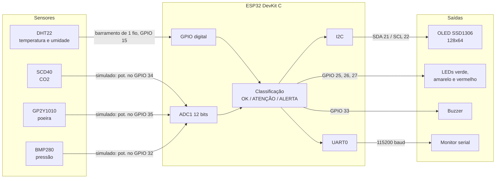
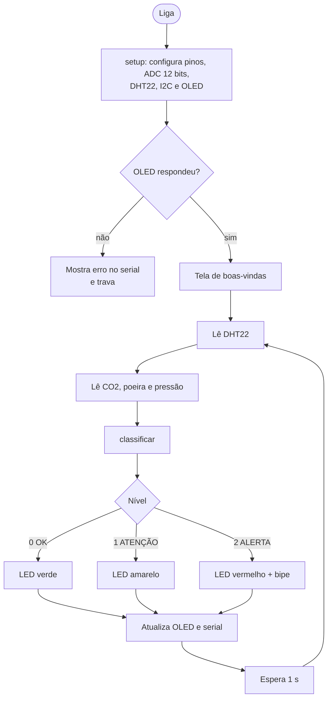

# Arquitetura do sistema embarcado

Este documento detalha as decisões técnicas do AirSense e serve de base para a
seção **2.6 – Detalhamento técnico do projeto** do Roteiro de Extensão.

## Sumário

- [Escolha do microcontrolador](#escolha-do-microcontrolador)
- [Diagrama de blocos](#diagrama-de-blocos)
- [Pinagem](#pinagem)
- [Periféricos internos utilizados](#periféricos-internos-utilizados)
- [Periféricos externos](#periféricos-externos)
- [Fluxo do firmware](#fluxo-do-firmware)
- [Rotinas e variáveis principais](#rotinas-e-variáveis-principais)
- [Melhorias planejadas](#melhorias-planejadas)

## Escolha do microcontrolador

Placa escolhida: **ESP32 DevKit C V4** (SoC ESP32-WROOM-32).

| Critério | Por que o ESP32 atende |
|---|---|
| Processamento | Dual-core Xtensa LX6 de até 240 MHz, com folga para ler sensores, atualizar o display e, futuramente, transmitir dados |
| Conectividade | Wi-Fi e Bluetooth integrados, o que viabiliza o envio dos dados para um dashboard remoto sem módulos extras |
| Conversão analógica | ADC de 12 bits (0–4095) com vários canais, suficiente para sensores analógicos como o GP2Y1010 |
| Barramentos | I2C, SPI e UART por hardware, compatíveis com o SCD40, o BMP280 e o OLED |
| Custo e tamanho | Placa compacta e barata, amplamente disponível no Brasil |
| Simulação | Suporte nativo no Wokwi, permitindo desenvolver e testar sem hardware físico |

## Diagrama de blocos

> Na simulação, os sensores de CO2, poeira e pressão são representados por
> potenciômetros ligados ao ADC. Na versão física, o SCD40 e o BMP280 passam
> para o barramento I2C e o GP2Y1010 continua no ADC (veja
> [Melhorias planejadas](#melhorias-planejadas)).

## Pinagem

| GPIO | Direção | Ligado a | Observação |
|---|---|---|---|
| 15 | Entrada/saída digital | DHT22 (dados) | Protocolo proprietário de 1 fio |
| 21 | I2C SDA | OLED SSD1306 | Endereço `0x3C` |
| 22 | I2C SCL | OLED SSD1306 | |
| 34 | Entrada analógica (ADC1_CH6) | Potenciômetro de CO2 | Pino somente de entrada |
| 35 | Entrada analógica (ADC1_CH7) | Potenciômetro de poeira | Pino somente de entrada |
| 32 | Entrada analógica (ADC1_CH4) | Potenciômetro de pressão | |
| 25 | Saída digital | LED verde (resistor de 220 Ω) | Status OK |
| 26 | Saída digital | LED amarelo (resistor de 220 Ω) | Status ATENÇÃO |
| 27 | Saída digital | LED vermelho (resistor de 220 Ω) | Status ALERTA |
| 33 | Saída digital | Buzzer | Onda quadrada de ~2 kHz |
| 1 / 3 | UART0 TX/RX | Monitor serial | 115200 baud |

**Por que só ADC1?** O ADC2 do ESP32 fica indisponível quando o Wi-Fi está
ativo. Como a transmissão dos dados por Wi-Fi está nos planos, todos os canais
analógicos foram colocados no ADC1 desde já.

## Periféricos internos utilizados

| Periférico | Uso no AirSense |
|---|---|
| **GPIO digital (saída)** | Acionamento dos três LEDs de status e do buzzer |
| **GPIO digital (entrada/saída)** | Comunicação com o DHT22 |
| **ADC** | Leitura de 12 bits (`analogReadResolution(12)`) dos sinais analógicos de CO2, poeira e pressão |
| **I2C** | Comunicação com o display OLED (biblioteca `Wire`) |
| **UART** | Log das leituras no monitor serial (`Serial.printf`) |
| **Temporizadores** | Base de tempo do ciclo de 1 s (`delay`) e geração da onda do buzzer (`delayMicroseconds`) |

## Periféricos externos

A lista completa, com especificações e equivalência entre simulação e
hardware real, está em [lista-de-materiais.md](lista-de-materiais.md).

## Fluxo do firmware

## Rotinas e variáveis principais

| Elemento | Tipo | Função |
|---|---|---|
| `CO2_ATENCAO`, `CO2_ALERTA` | `const float` | Limiares de CO2 em ppm |
| `DUST_ATENCAO`, `DUST_ALERTA` | `const float` | Limiares de poeira em µg/m³ |
| `TEMP_MIN`, `TEMP_MAX` | `const float` | Faixa de temperatura aceitável em °C |
| `UMID_MIN`, `UMID_MAX` | `const float` | Faixa de umidade relativa aceitável em % |
| `lerCO2()` | função | Converte a leitura do ADC (0–4095) para 400–2000 ppm |
| `lerPoeira()` | função | Converte a leitura do ADC para 0–150 µg/m³ |
| `lerPressao()` | função | Converte a leitura do ADC para 950–1050 hPa |
| `classificar()` | função | Retorna `0` (OK), `1` (ATENÇÃO) ou `2` (ALERTA) |
| `apitar()` | função | Gera ~100 ms de onda quadrada de ~2 kHz no buzzer |
| `dhtOk` | `bool` | Indica se a leitura do DHT22 foi válida no ciclo atual |

### Regras de classificação

1. **ALERTA** se CO2 > 1000 ppm **ou** poeira > 80 µg/m³.
2. Senão, **ATENÇÃO** se CO2 > 800 ppm **ou** poeira > 64 µg/m³.
3. Se ainda estiver em **OK**, passa para **ATENÇÃO** quando a temperatura sai
   de 23–26 °C ou a umidade sai de 40–65 %.
4. Se o DHT22 falhar, temperatura e umidade ficam de fora da classificação
   e o display mostra `-- (erro)`.

## Melhorias planejadas

Estes pontos cobrem habilidades pedidas na disciplina que ainda não aparecem
no código:

- **PWM:** gerar o tom do buzzer com o periférico LEDC (`ledcWriteTone`) em vez
  de alternar o pino manualmente, liberando a CPU durante o bipe.
- **Interrupções e temporizadores por hardware:** usar um timer para disparar
  as leituras a cada 1 s e um botão com interrupção para silenciar o alarme.
- **Sensores reais no I2C:** SCD40 (`0x62`) e BMP280 (`0x76`/`0x77`)
  compartilhando o barramento com o OLED.
- **GP2Y1010 físico:** o LED infravermelho interno precisa de um pulso de
  0,32 ms a cada 10 ms, com a leitura feita ~0,28 ms após o início do pulso. A
  saída analógica pode passar de 3,3 V, então é preciso um divisor de tensão
  antes do ADC do ESP32.
- **Envio dos dados por Wi-Fi** para um dashboard, permitindo a análise
  histórica prevista nas metas do projeto.
