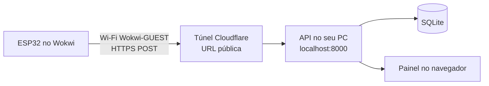

# Como rodar o AirSense

Este guia vai do mais simples ao mais completo. Escolha o caminho de acordo
com o que você quer mostrar:

| Caminho | O que roda | Tempo | Precisa instalar |
|---|---|---|---|
| [**A** · Só a simulação](#caminho-a--só-a-simulação-no-navegador) | ESP32 no Wokwi: display, LEDs e alarme | ~5 min | Nada |
| [**B** · Simulação + API + painel](#caminho-b--simulação--api--painel) | Tudo do A + dados chegando no painel web | ~20 min | Python e cloudflared |
| [**C** · Tudo no VS Code](#caminho-c--tudo-no-vs-code-opcional) | Igual ao B, sem túnel e sem copiar e colar | ~30 min na 1ª vez | VS Code, arduino-cli, Python |

Ao final há uma seção de [problemas comuns](#problemas-comuns).

---

## Antes de começar: baixe o projeto

**Com Git:**

```bash
git clone https://github.com/DaviFCSilva/air-sense.git
cd air-sense
```

**Sem Git:** no GitHub, clique em **Code → Download ZIP** e extraia.

---

## Caminho A · Só a simulação no navegador

Roda o dispositivo completo (sensores, display, LEDs e buzzer) sem instalar
nada e sem enviar dados.

1. Abra **<https://wokwi.com/projects/new/esp32>**. Se quiser salvar o projeto
   depois, entre com sua conta.
2. **`sketch.ino`:** apague o conteúdo da aba e cole o de
   [`firmware/airsense/airsense.ino`](../firmware/airsense/airsense.ino).
   No Wokwi, o arquivo principal sempre se chama `sketch.ino`.
3. **`diagram.json`:** apague e cole o conteúdo de
   [`firmware/airsense/diagram.json`](../firmware/airsense/diagram.json).
   O circuito aparece montado ao lado.
4. **Arquivos `.h`:** clique na setinha **▾** ao lado das abas → **New file…**
   e crie quatro arquivos, com estes nomes exatos, colando o conteúdo de cada um:
   - `config.h`
   - `sensores.h`
   - `alertas.h`
   - `rede.h`
5. **`libraries.txt`:** crie mais um arquivo com esse nome e cole o conteúdo de
   [`firmware/airsense/libraries.txt`](../firmware/airsense/libraries.txt).
   É ele que faz o Wokwi instalar as bibliotecas do display e do DHT22.
6. Clique em ▶️ **Start the simulation**.

**O que você deve ver:**
- O display mostra "AirSense / Iniciando..." e, depois, as leituras.
- No monitor serial (embaixo), aparece a linha
  `API_URL vazia: rodando sem enviar dados`. Isso é o esperado neste caminho.

**Para testar:**
- Gire o potenciômetro do **CO2** para o máximo. O LED vermelho acende, o
  buzzer apita e o display mostra `[ALERTA]`.
- Clique no **DHT22** durante a simulação e mude a temperatura para 30 °C.
  Com CO2 e poeira baixos, o LED amarelo acende (`[ATENCAO]`).

> 💡 **Dica para o grupo:** depois de montar uma vez, clique em **Save** e
> compartilhe o link. Assim ninguém precisa copiar e colar de novo. Quando
> alguém salvar, coloque o link no README.

---

## Caminho B · Simulação + API + painel

O ESP32 simulado envia uma leitura a cada 5 segundos para a API, que guarda os
dados e mostra tudo no painel.

**Por que precisa de túnel?** O ESP32 do wokwi.com roda nos servidores do
Wokwi e sai para a internet pela rede virtual `Wokwi-GUEST`. Ele **não
enxerga o `localhost` do seu computador**. O túnel cria uma URL pública
(`https://...trycloudflare.com`) que aponta para a API rodando na sua máquina.



### B1. Instale o Python

Você precisa do Python 3.10 ou mais novo. Confira com `python --version`.
Se não tiver, baixe em <https://www.python.org/downloads/>. No Windows, marque
**"Add python.exe to PATH"** na instalação.

### B2. Prepare a API (só na primeira vez)

No terminal, dentro da pasta do projeto:

```bash
cd api
python -m venv .venv
```

Ative o ambiente virtual:

| Sistema | Comando |
|---|---|
| Windows (PowerShell) | `.venv\Scripts\Activate.ps1` |
| Windows (cmd) | `.venv\Scripts\activate.bat` |
| Linux / Mac | `source .venv/bin/activate` |

> Se o PowerShell bloquear o script, rode uma vez
> `Set-ExecutionPolicy -Scope CurrentUser RemoteSigned` e tente de novo.

Instale as dependências e crie o `.env`:

```bash
pip install -r requirements.txt
cp .env.example .env            # Windows: copy .env.example .env
```

Gere uma chave e coloque no `.env`:

```bash
python -c "import secrets; print(secrets.token_urlsafe(24))"
```

Abra o `api/.env` e troque `troque-esta-chave` pela chave gerada:

```
API_KEY=Xk3v9...a-chave-que-apareceu
```

### B3. Suba a API

```bash
uvicorn main:app --reload --port 8000
```

Deixe esse terminal aberto e abra **<http://localhost:8000>**. O painel aparece
com a mensagem "Nenhuma leitura recebida ainda".

**Teste sem o Wokwi (opcional, recomendado):** em **outro terminal**, com o
ambiente ativado, rode:

```bash
cd api
python enviar_teste.py
```

Em poucos segundos, o painel mostra 20 leituras falsas. Se funcionou, a API
está pronta.

### B4. Abra o túnel

Instale o **cloudflared**. É gratuito e não precisa de conta:

| Sistema | Comando |
|---|---|
| Windows | `winget install --id Cloudflare.cloudflared` |
| Mac | `brew install cloudflared` |
| Linux | veja <https://developers.cloudflare.com/cloudflare-one/connections/connect-networks/downloads/> |

Em **um terceiro terminal**:

```bash
cloudflared tunnel --url http://localhost:8000
```

Procure na saída uma linha parecida com esta e copie a URL:

```
https://palavras-aleatorias-aqui.trycloudflare.com
```

Para conferir, abra essa URL no navegador: o mesmo painel deve aparecer.

> ⚠️ A URL muda **toda vez** que você roda o cloudflared. Se fechar e abrir de
> novo, atualize o `secrets.h` (próximo passo).

### B5. Configure o firmware

Monte a simulação como no [Caminho A](#caminho-a--só-a-simulação-no-navegador)
(ou abra o projeto que o grupo salvou). Depois, crie mais um arquivo no
Wokwi chamado **`secrets.h`**, cole o conteúdo de
[`secrets.example.h`](../firmware/airsense/secrets.example.h) e preencha:

```cpp
#define WIFI_SSID   "Wokwi-GUEST"
#define WIFI_SENHA  ""
#define API_URL     "https://palavras-aleatorias-aqui.trycloudflare.com/leituras"
#define API_KEY     "Xk3v9...a-mesma-chave-do-api-env"
#define DEVICE_ID   "airsense-01"
```

- `API_URL` é a URL do túnel **seguida de `/leituras`**.
- `API_KEY` precisa ser **idêntica** à do `api/.env`.

> 🔒 Nunca coloque o `secrets.h` no GitHub. Ele já está no `.gitignore`.
> No Wokwi, quem tiver o link de um projeto salvo vê todos os arquivos,
> inclusive o `secrets.h`. Para a apresentação isso não é problema, mas gere
> uma chave nova depois.

### B6. Rode e confira

Clique em ▶️. No monitor serial do Wokwi, você deve ver:

```
Conectando ao Wi-Fi "Wokwi-GUEST"......
Wi-Fi conectado! IP: 10.10.0.2
T=24.5C U=55% CO2=400ppm PM=0ug/m3 P=950hPa nivel=0 (OK)
POST https://...trycloudflare.com/leituras -> 201
```

<sub>Os valores dependem da posição dos potenciômetros e do DHT22.</sub>

`201` significa que a leitura foi gravada. Abra o painel: a cada 5 segundos
chega uma leitura nova. Gire os potenciômetros e veja os gráficos mudarem.
No display, o **W** no canto superior direito indica Wi-Fi conectado.

---

## Caminho C · Tudo no VS Code (opcional)

A extensão do Wokwi para VS Code inclui um gateway que deixa o ESP32 simulado
acessar o seu computador pelo nome `host.wokwi.internal`. Assim, **não precisa
de túnel**, e o código é compilado direto dos arquivos do repositório.

1. Instale o [VS Code](https://code.visualstudio.com/), a extensão
   [Wokwi Simulator](https://marketplace.visualstudio.com/items?itemName=wokwi.wokwi-vscode)
   e o [arduino-cli](https://arduino.github.io/arduino-cli/latest/installation/).
2. Na primeira vez, pressione **F1 → Wokwi: Request a New License** e siga as
   instruções. A licença gratuita precisa ser renovada de tempos em tempos.
3. Instale o core do ESP32 e as bibliotecas (só uma vez):
   ```bash
   arduino-cli config init
   arduino-cli config add board_manager.additional_urls https://espressif.github.io/arduino-esp32/package_esp32_index.json
   arduino-cli core update-index
   arduino-cli core install esp32:esp32
   arduino-cli lib install "Adafruit GFX Library" "Adafruit SSD1306" "DHT sensor library"
   ```
4. Crie o `firmware/airsense/secrets.h` (copiando o `secrets.example.h`) com:
   ```cpp
   #define API_URL "http://host.wokwi.internal:8000/leituras"
   #define API_KEY "a-mesma-chave-do-api-env"
   ```
5. Suba a API como nos passos [B2](#b2-prepare-a-api-só-na-primeira-vez) e
   [B3](#b3-suba-a-api).
6. Compile o firmware:
   ```bash
   arduino-cli compile --fqbn esp32:esp32:esp32 --output-dir firmware/airsense/build firmware/airsense
   ```
7. No VS Code, abra `firmware/airsense/diagram.json` e pressione
   **F1 → Wokwi: Start Simulator**.

Sempre que alterar o código, repita o passo 6 e reinicie a simulação.

> Se o POST falhar com `host.wokwi.internal`, tente subir a API com
> `uvicorn main:app --host 0.0.0.0 --port 8000`. Se ainda assim não der certo,
> use o túnel do [passo B4](#b4-abra-o-túnel), que funciona igual no VS Code.

---

## Rodar os testes

```bash
cd api
pip install -r requirements-dev.txt
pytest
```

O GitHub Actions roda esses testes e compila o firmware a cada push. O
resultado aparece na aba **Actions** do repositório e no selo do README.

---

## Problemas comuns

| Sintoma | Causa provável | O que fazer |
|---|---|---|
| Serial: `API_URL vazia: rodando sem enviar dados` | Não há `secrets.h` | Normal no Caminho A. Para enviar, siga o [B5](#b5-configure-o-firmware) |
| Serial: `POST ... -> 401` | Chave diferente entre `secrets.h` e `api/.env` | Copie a chave de novo, sem espaços ou aspas a mais |
| Serial: `POST ... -> 422` | Dados fora do formato | Veja o motivo em `http://localhost:8000/docs` ou no terminal da API |
| Serial: `POST ... -> 503` | A API está sem `API_KEY` | Crie o `api/.env` (passo B2) e reinicie a API |
| Serial: `POST ... falhou: connection refused` | URL errada, túnel fechado ou `localhost` no wokwi.com | Confira se o cloudflared está aberto e se a URL termina em `/leituras` |
| Serial: `Sem Wi-Fi` | SSID errado | No Wokwi, use exatamente `Wokwi-GUEST`, com senha vazia |
| Painel: "Sem conexão com a API" | A API caiu | Veja o terminal do `uvicorn` |
| Painel: "Sem dados recentes" | Simulação pausada ou túnel fechado | Normal quando o Wokwi está parado |
| Wokwi: `fatal error: config.h: No such file` | Faltou criar uma aba `.h` | Crie os quatro `.h` com os nomes exatos (passo A4) |
| Wokwi: erro de `Adafruit_SSD1306.h` ou `DHT.h` | Faltou o `libraries.txt` | Passo A5 |
| `uvicorn` não é reconhecido | Ambiente virtual desativado | Ative o `.venv` (passo B2) |
| `.venv\Scripts\Activate.ps1` bloqueado | Política do PowerShell | `Set-ExecutionPolicy -Scope CurrentUser RemoteSigned` |
