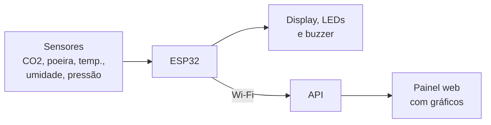

# Resumo do projeto AirSense

> Situação em **27/10/2026**. Atualize este arquivo sempre que uma etapa for concluída.

## Em uma frase

O **AirSense** é um aparelho de baixo custo que mede o ar de um escritório
(CO2, poeira, temperatura, umidade e pressão), mostra os valores em um display,
avisa com luz e som quando o ar fica ruim e envia os dados para um painel na web.

## O problema

Em escritórios fechados com ar-condicionado, o ar quase não se renova. O CO2 e
a poeira se acumulam, e as pessoas sentem sono, dor de cabeça e perdem
concentração sem saber o motivo. Um estudo de Harvard mostrou que, com o ar bem
ventilado, o desempenho cognitivo dos trabalhadores dobrou. Medidores
comerciais existem, mas são caros. O AirSense quer ser uma alternativa barata.

**Para quem:** os colaboradores de um escritório corporativo parceiro.
**Contexto:** projeto extensionista da disciplina de Microcontroladores, na
Estácio Ribeirânia, orientado pelo **Prof. Omar Donaires**.

## Como funciona

1. A cada **1 segundo**, o ESP32 lê os sensores.
2. Compara os valores com os limites da **ANVISA (RE nº 9/2003)** e decide o nível:

   | Nível | LED | Quando |
   |---|---|---|
   | 🟢 OK | verde | tudo dentro dos limites |
   | 🟡 ATENÇÃO | amarelo | CO2 > 800 ppm, poeira > 64 µg/m³, ou temperatura/umidade fora do conforto |
   | 🔴 ALERTA | vermelho + bipe | CO2 > 1000 ppm ou poeira > 80 µg/m³ |

3. Mostra tudo no display.
4. A cada **5 segundos**, envia a leitura pela internet para a API, que guarda
   o histórico e mostra no painel.

**Hoje tudo roda em simulação** no Wokwi. O DHT22, o display, os LEDs e o
buzzer são simulados de verdade. Os sensores de CO2, poeira e pressão são
representados por potenciômetros (botões giratórios), porque o Wokwi não tem
esses sensores.

## Onde está cada coisa

| Parte | Pasta | Explicação detalhada |
|---|---|---|
| Firmware do ESP32 + circuito do Wokwi | [`firmware/airsense/`](../firmware/airsense/) | [arquitetura.md](arquitetura.md) |
| API e painel web | [`api/`](../api/) | [api/README.md](../api/README.md) |
| Lista de componentes | — | [lista-de-materiais.md](lista-de-materiais.md) |
| Decisões técnicas | — | [decisoes.md](decisoes.md) |
| Como rodar | — | [como-rodar.md](como-rodar.md) |

## Situação geral

| Etapa | Situação |
|---|---|
| Diagnóstico e teorização (roteiro 1.1 a 1.5) | ✅ Entregue |
| Planejamento (roteiro 2.1 a 2.5) | ✅ Entregue |
| Contato com o escritório parceiro | ✅ Feito |
| Simulação no Wokwi (sensores, display, LEDs, buzzer) | ✅ Pronta |
| Envio dos dados por Wi-Fi | ✅ Pronto |
| API e painel web | ✅ Prontos |
| Repositório organizado, documentado e com CI | ✅ Pronto |
| Validação da proposta técnica com o escritório | ⏳ Registrar |
| Sensores reais, montagem física e calibração | ⏳ A fazer |
| Testes de integração e de estabilidade | ⏳ A fazer |
| Detalhamento técnico (roteiro 2.6) e encerramento (roteiro 3) | ⏳ A fazer |
| Apresentação ao escritório e avaliação de reação | ⏳ A fazer |

## Próximas datas (cronograma do roteiro)

| Data | O quê |
|---|---|
| **28/10** | Seminário de desenvolvimento: demonstração do protótipo |
| até **11/11** | Testes individuais e de integração, calibração e ajustes |
| até **18/11** | Apresentação ao escritório parceiro e avaliação de reação |
| **25/11** | Entrega final do roteiro e Seminário de Avaliação |

---

## O que cada um já fez e os próximos passos

### Davi · Documentação e relação com o escritório

**Já fez**
- Redigiu o Roteiro de Extensão até o item 2.5 (diagnóstico, planejamento,
  cronograma, metas, indicadores e recursos).
- Fez o contato com o escritório parceiro.
- Criou e organizou o repositório: estrutura, README, documentação técnica,
  guia de execução e CI (compilação do firmware e testes da API).
- Integrou o código de Wi-Fi do grupo ao firmware e criou a API e o painel web.

**Próximos passos**
1. Registrar a validação da proposta técnica com o escritório (prevista para
   14/10), com evidências: fotos, mensagens ou ata.
2. Escrever o item 2.6 do roteiro a partir de [arquitetura.md](arquitetura.md)
   e [lista-de-materiais.md](lista-de-materiais.md).
3. Agendar a apresentação ao escritório (até 18/11) e preparar, com o Pedro, o
   formulário de avaliação de reação (item 3.2).
4. Reunir as evidências do projeto (fotos, vídeos e prints) para a entrega final.
5. Manter este resumo atualizado.

### Vinicius Barbosa · Firmware

**Já fez**
- Escreveu, junto com o Gabriel, o firmware da simulação: leitura dos sensores,
  classificação OK/ATENÇÃO/ALERTA, display OLED, LEDs e buzzer.
- Escreveu, junto com o Gabriel, o código de conexão Wi-Fi e envio das
  leituras para a API.

**Próximos passos**
1. Revisar o firmware reorganizado em módulos (`config.h`, `sensores.h`,
   `alertas.h` e `rede.h`) e testar no Wokwi.
2. Usar **interrupções**, item cobrado na disciplina:
   - um timer por hardware para disparar a leitura a cada 1 s;
   - um botão com interrupção para silenciar o alarme (o Gabriel adiciona o
     botão no circuito).
3. Implementar a leitura dos sensores reais no `sensores.h`, no bloco
   `MODO_SIMULACAO 0`: SCD40 e BMP280 pelo I2C, e GP2Y1010 pelo ADC, com o
   pulso do LED infravermelho.
4. Escrever o item 4.2.3 do roteiro: descrição do programa, variáveis e rotinas.

### Gabriel · Hardware e calibração

**Já fez**
- Montou o circuito no Wokwi (`diagram.json`): ESP32, DHT22, OLED,
  potenciômetros, LEDs com resistores e buzzer.
- Escreveu, junto com o Vinicius, o firmware da simulação e o código de Wi-Fi.

**Próximos passos**
1. Adicionar ao `diagram.json` um botão para silenciar o alarme (usado na
   interrupção do Vinicius).
2. Decidir com o grupo se haverá protótipo físico. Se sim, levantar preços e
   comprar os componentes da [lista de materiais](lista-de-materiais.md).
3. Projetar o circuito do GP2Y1010 (resistor de 150 Ω, capacitor de 220 µF e
   divisor de tensão para o ADC de 3,3 V).
4. Montar na protoboard, calibrar os sensores contra uma referência e
   fotografar cada etapa.
5. Escrever os itens 4.2.1 e 4.2.2 do roteiro: lista de materiais e montagem
   do circuito.

### Pedro Borges · Testes e exibição dos dados

**Já fez**
- Ainda sem entregas registradas no repositório. A API e o painel criados
  agora são a base da parte dele.

**Próximos passos**
1. Rodar a API e o painel ([como-rodar.md](como-rodar.md), Caminho B) e
   assumir essa parte: melhorias no painel, filtros por período e
   exportação em CSV.
2. Executar os testes previstos nas metas do roteiro e registrar os resultados:
   - **alertas:** 100% dos cenários com o nível correto (ex.: CO2 acima de
     1000 ppm → ALERTA);
   - **estabilidade:** 8 horas seguidas sem falha (simulação ligada enviando
     para a API);
   - **análise:** identificar horários críticos na série de dados.
3. Escrever os itens 4.3.1 e 4.3.2 do roteiro (testes individuais e de
   integração), com prints do painel.
4. Preparar, com o Davi, o formulário de avaliação de reação do escritório.

---

## Tarefas do grupo todo

- [ ] Ensaiar a demonstração do seminário de 28/10. O Caminho A do
      [como-rodar.md](como-rodar.md) basta; com o painel, fica mais completa.
- [ ] Salvar o projeto no Wokwi e colocar o link no README.
- [ ] Decidir se haverá protótipo físico ou só simulação (o roteiro aceita os dois).
- [ ] Cada integrante escrever o seu relato individual (roteiro 3.3).
